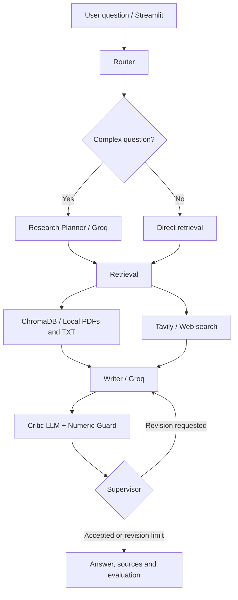

# ResearchFlow AI

**A multi-agent research assistant combining document retrieval, web search, structured planning, answer generation, and automated evaluation.**

ResearchFlow AI is a hands-on AI engineering project built with **LangGraph, Groq, ChromaDB, Sentence Transformers, Tavily, Pydantic, and Streamlit**. It lets users upload PDF/TXT documents, ask research questions, and generate source-grounded answers with an evaluation and revision workflow.

> **Project status:** Working local prototype. Cloud deployment is planned; a public demo is not yet available.

## Key features

- **Document ingestion:** Extract text from PDF/TXT files, split it into chunks, generate embeddings, and index them in ChromaDB.
- **Incremental indexing:** Add a document without rebuilding the entire vector database.
- **Document selection:** Search across all indexed files or restrict retrieval to a selected document.
- **Hybrid retrieval:** Combine local semantic search with Tavily web search.
- **Research Planner:** Decompose complex questions into sub-questions before retrieval; skip planning for simpler queries.
- **LangGraph orchestration:** Coordinate routing, retrieval, writing, evaluation, and revisions through a shared state.
- **Writer:** Produce French answers grounded in retrieved passages, with source references such as `[S1]`.
- **Critic and Numeric Guard:** Evaluate responses with an LLM and targeted deterministic numeric checks; request revisions when needed.
- **Streamlit interface:** Upload files, choose the retrieval mode, inspect sources and evaluation results, and export a Markdown report.

## Architecture



The routing stage supports four modes: `auto`, `document`, `web`, and `hybride`. The exact execution path depends on the selected mode, question, and available sources. The revision loop is capped at two revisions.

## Tech stack

| Layer | Technology |
| --- | --- |
| Agent orchestration | LangGraph |
| LLM and research planning | Groq API |
| Structured output and validation | Pydantic |
| Embeddings | Sentence Transformers (`paraphrase-multilingual-MiniLM-L12-v2`) |
| Vector database | ChromaDB (local persistent collection) |
| Web search | Tavily API |
| PDF processing | pypdf |
| User interface | Streamlit |
| Language | Python 3.12 (local development) |

## Getting started

### 1. Clone the repository

```bash
git clone https://github.com/Eya-Nakkaii/ResearchFlow-AI.git
cd ResearchFlow-AI
```

### 2. Create a Python environment

Python 3.12 is used for local development.

```bash
python3.12 -m venv .venv
source .venv/bin/activate
python -m pip install -r requirements.txt
```

On Windows, activate the environment with `.venv\Scripts\activate` instead.

### 3. Configure API keys

Copy `.env.example` to `.env` and set the required keys:

```bash
cp .env.example .env
```

```dotenv
GROQ_API_KEY=your_groq_api_key
GROQ_MODEL=openai/gpt-oss-20b
TAVILY_API_KEY=your_tavily_api_key
```

Never commit `.env` or real API keys.

### 4. Start the application

```bash
python -m streamlit run app.py
```

Open the local address displayed by Streamlit (usually `http://localhost:8501`). Upload a PDF/TXT from the sidebar and index it before selecting it for document-based questions.

## Example workflow

1. Upload and index a PDF report.
2. Select the document under **Document à interroger**.
3. Choose `document` for document-only questions or `hybride` to compare it with external material.
4. Ask a question, for example: *Compare the anomaly detection methods in my report with recent approaches.*
5. Review the generated answer, retrieved source passages, Critic feedback, and Markdown export.

## Main project modules

| File | Responsibility |
| --- | --- |
| `app.py` | Streamlit user interface |
| `graph_hybrid.py` | LangGraph state and orchestration |
| `planner.py` | Groq-based research planning |
| `schemas.py` | Pydantic research plan schema |
| `rag_prepare.py` | Document loading and chunking |
| `embeddings.py` | Sentence Transformer embeddings |
| `vector_store.py` | ChromaDB indexing and semantic retrieval |
| `web_search.py` | Tavily web search |
| `evaluator.py` | LLM-based response evaluation |
| `quality_checks.py` | Deterministic numeric consistency checks |

## Limitations and next steps

This is a **portfolio/research prototype**, not a production-grade fact-verification system.

- LLM evaluation scores do **not** guarantee factual correctness.
- The Numeric Guard only checks supported numeric patterns; `0` checked claims means it did not verify numeric statements in that response.
- Web search and model calls depend on third-party APIs, their quotas, and network access.
- ChromaDB and uploaded documents are stored locally; persistence and data isolation must be designed explicitly for cloud hosting.
- Public deployment will require abuse prevention, limits on uploads/API usage, and review of secret management and dependency compatibility.

**Planned:** a deployment-ready Streamlit demo, hardened citation validation, and further evaluation of research quality.

## Security

Do not upload confidential documents to a public demo. API keys belong in environment variables or the hosting platform's secret manager. Local `.env`, ChromaDB data, and uploaded documents are excluded from new Git commits by `.gitignore`; files committed previously may still exist in Git history.

## Author

Developed as a hands-on project to explore **AI engineering, retrieval-augmented generation (RAG), agent orchestration, and LLM evaluation**.
